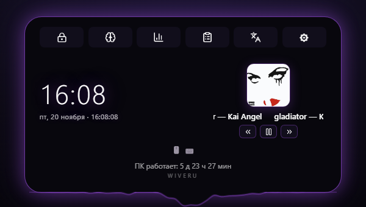

# Wiveru 🏝️

Dynamic Island для Windows в стиле «пилюли» — всегда виджет на рабочем столе с часами, медиа-контролами, мониторингом системы, буфером обмена, переводчиком и **голосовым ИИ-ассистентом на русском языке**.

<p align="center">
  
</p>

## Возможности

- **Голосовой ассистент** — скажи «Виверу» и задавай вопросы голосом. Локальный STT (GigaAM, русский) + ИИ (облако Pollinations/OpenAI-compatible/Gemini или локальная Qwen через llama.cpp)
- **Медиа-визуализация** — волна под островом и свечение в такт басу, только для музыки (видео отсекается)
- **Медиа-контролы** — обложка, название, prev/play/next для любого плеера через Windows SMTC
- **Мониторинг** — CPU / GPU / RAM / батарея / устройства
- **Буфер обмена** — история последних 5 текстов, клик копирует обратно
- **Переводчик** — встроенный, через MyMemory API, автоперевод при вводе
- **Zapret** — быстрый запуск DPI-bypass из интерфейса
- **Голосовое понижение громкости** — только на время распознавания команды

<p align="center">
  
</p>

<p align="center">
  
</p>

> Скриншоты — плейсхолдеры: положи свои PNG/JPG в `docs/` с именами `screenshot-main.png`, `screenshot-expanded.png`, `screenshot-panels.png`.

## Установка

### 1. Клонирование

```bash
git clone https://github.com/<твой-ник>/wiveru.git
cd wiveru
```

### 2. Зависимости Node.js

```bash
npm install
```

### 3. Модели (скачать отдельно — не входят в репозиторий)

Веса нейросетей слишком большие для GitHub, поэтому их нужно скачать вручную.

**Локальный ИИ (Qwen, GGUF)** — положи один файл в `models/`:

| Файл | Где скачать |
|---|---|
| `Qwen3-4B-Instruct-2507-Q4_K_M.gguf` (~2.5 ГБ) | [HuggingFace — Qwen](https://huggingface.co/Qwen) |
| `qwen2.5-1.5b-instruct-q4_k_m.gguf` (~1 ГБ) | [HuggingFace — Qwen2.5-1.5B](https://huggingface.co/Qwen/Qwen2.5-1.5B-Instruct-GGUF) |
| `Qwen3-8B-Q4_K_M.gguf` (~5 ГБ) | [HuggingFace — Qwen3-8B](https://huggingface.co/Qwen/Qwen3-8B-GGUF) |

Достаточно одного файла — код сам выберет первый найденный.

**STT для голоса (GigaAM, русский)** — скачай sherpa-onnx модель и положи в `models/gigaam/`:

- `sherpa-onnx-nemo-ctc-punct-giga-am-v3-russian` — с [GitHub sherpa-onnx releases](https://github.com/k2-fsa/sherpa-onnx/releases) или [HuggingFace](https://huggingface.co/collections/csukuangfj/sherpa-onnx-tts-ru-67f52d1397fa48a6a209bedb)

Внутри папки должны лежать `model.int8.onnx` и `tokens.txt`.

**Python venv для STT** (опционально, если есть GPU/CPU ONNX-runtime):

```bash
python -m venv stt-venv
stt-venv\Scripts\pip install sherpa-onnx
```

### 4. Конфигурация

Скопируй примеры конфигов и отредактируй под себя:

```bash
copy ai-config.example.json ai-config.json
copy settings.example.json settings.json
```

- `ai-config.json` — API-ключи ИИ (можно оставить Pollinations — работает без ключа)
- `settings.json` — путь к Zapret (`zapretBat`), голос, волны

### 5. Zapret (отдельно)

Zapret в репозиторий **не входит** — у каждого свой путь и версия. Скачай [zapret](https://github.com/bol-van/zapret) отдельно, укажи путь к `general.bat` в настройках острова (⚙ → «Путь к general.bat»).

### 6. Запуск

```bash
npm start
```

## Что скачивается отдельно (не в репозитории)

| Что | Размер | Зачем |
|---|---|---|
| GGUF-модель Qwen | 1–5 ГБ | Локальный ИИ-фолбэк |
| GigaAM STT (sherpa-onnx) | ~200 МБ | Распознавание русской речи |
| `stt-venv` + sherpa-onnx | ~300 МБ | Python-окружение STT |
| `hf-cache` | ~2 ГБ | Кэш HuggingFace (создаётся сам) |
| Zapret | ~50 МБ | Обход DPI-блокировок |
| `node_modules` | ~300 МБ | `npm install` |

## Структура

```
main.js          — Electron main: окна, IPC, ИИ, STT, медиа, перевод
script.js        — renderer: UI, волна, голосовой цикл, панели
style.css        — стили Dynamic Island
index.html       — разметка
stt_server.py    — GigaAM STT сервер
assets/btn/      — PNG-иконки кнопок
models/          — ИИ-модели (gitignore)
settings.json    — пользовательские настройки (gitignore)
ai-config.json   — ключи ИИ (gitignore)
```

## Лицензия

MIT
